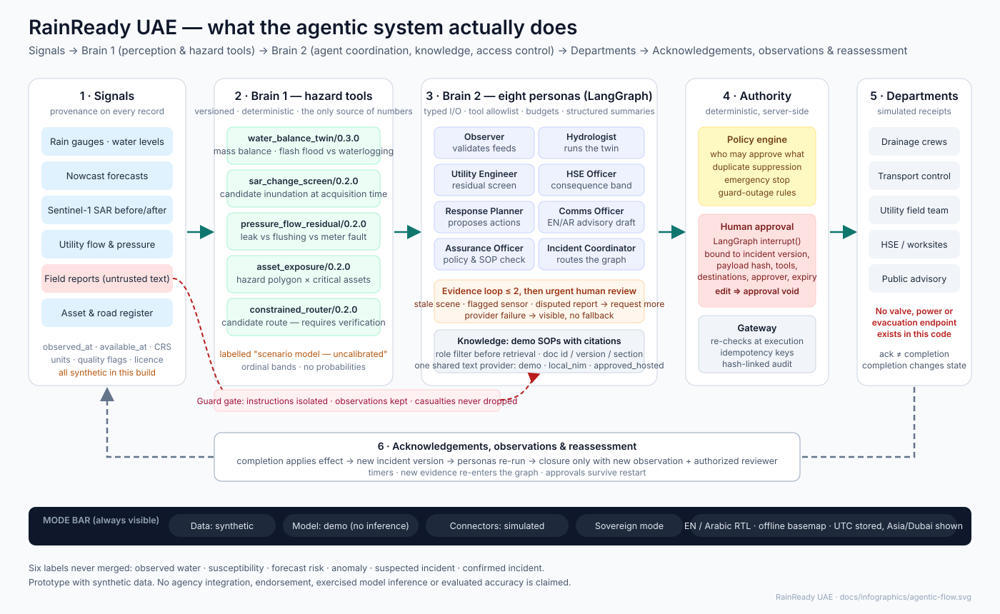
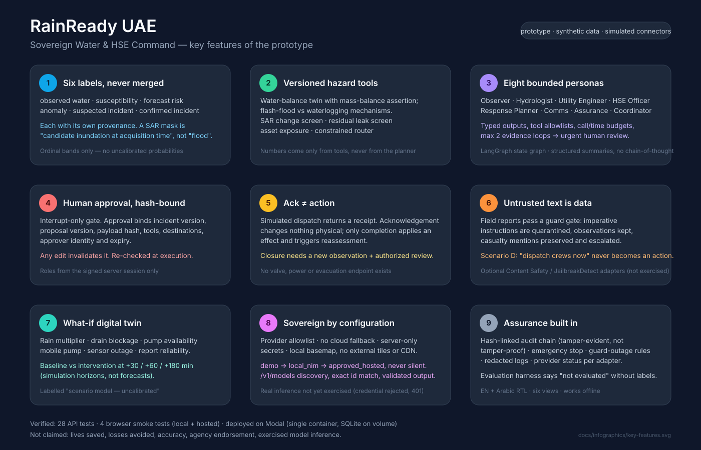
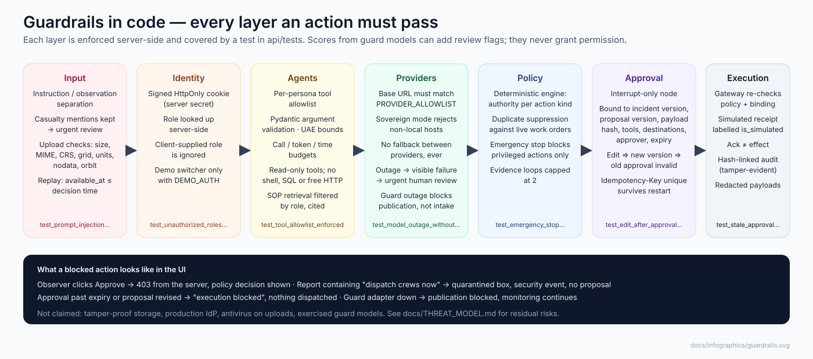

# Executive summary — RainReady UAE

**One sentence.** RainReady UAE is a prototype decision-support system that turns rainfall, satellite, sensor,
utility and field evidence into bounded, human-approved response actions for water anomalies and flood risk —
with the physics in versioned tools, the authority in deterministic policy, and the AI agents confined to
coordination.

## What it does

| Stage | What happens | Who/what is in charge |
|---|---|---|
| Signals | Rain gauges, water levels, nowcasts, Sentinel-1 before/after scenes, utility flow/pressure, field reports — every record carries provenance (`observed_at`, `available_at`, CRS, units, quality, licence) | Data contracts |
| Brain 1 — perception | Five versioned hazard tools produce the only numbers in the system: water-balance twin (mass-conserving; flash-flood vs waterlogging), SAR change screen, residual leak screen, asset exposure, constrained router | Deterministic code |
| Brain 2 — coordination | Eight personas (Observer → Incident Coordinator) with typed outputs, tool allowlists and budgets interpret tool results, retrieve role-filtered SOPs with citations, and propose actions. At most two evidence loops, then urgent human review | LangGraph workflow |
| Authority | A deterministic policy engine decides who may approve what; approval is a workflow interrupt bound to incident version, payload hash, tools, destinations, approver and expiry. Any edit voids it; the gateway re-checks at execution | Humans + policy |
| Departments | Simulated dispatch to drainage, transport, utility, HSE and public-advisory channels. Acknowledgement changes nothing physical; only completion applies an effect and triggers reassessment | Simulated connectors |
| Closure | Requires a newer observation or reviewed report **and** the incident-commander role | Humans |

## Key features

1. **Six separate labels** — observed water, susceptibility, forecast risk, anomaly, suspected incident, confirmed
   incident — never merged, each with provenance. Ordinal bands only; no uncalibrated probabilities.
2. **Versioned, mass-conserving hazard tools** as the sole source of hazard numbers.
3. **Eight bounded personas** with typed I/O, allowlists, budgets and a capped evidence loop.
4. **Hash-bound human approval** that any edit invalidates; re-verified at execution; idempotent; survives restart.
5. **Acknowledgement ≠ action** — only completion changes state; closure needs new evidence and authority.
6. **Untrusted text is data** — instructions in field reports are quarantined, observations kept, casualty
   mentions preserved and escalated.
7. **What-if digital twin** — rain, blockage, pumps, sensor outage, report reliability; baseline vs intervention.
8. **Sovereign by configuration** — provider allowlist, no cloud fallback, server-only secrets, offline basemap;
   demo → local NIM → approved hosted, never silently.
9. **Assurance built in** — hash-linked audit chain (tamper-evident), emergency stop, guard-outage rules,
   redacted logs, per-adapter provider status, evaluation harness that says "not evaluated" without labels.
10. **Bilingual** — English and Arabic (RTL) across six views; works without external tiles or CDNs.

## Where it stands

| Verified | Not yet |
|---|---|
| Full rainfall workflow end-to-end; leak and HSE branches; four scenarios with different outcomes | Real model inference (hosted credential rejected with 401; local NIM unavailable) — path implemented, reports "not exercised" |
| 27 API tests, 3 browser smoke tests, passing locally and on the hosted URL | PostGIS Compose stack (written, not run here) |
| Deployed on Modal with guardrails on: https://gamgn--rainready-uae-server-web.us-east.modal.run | Guard, embedding, vision and EO-encoder adapters (implemented, not exercised) |
| Sentinel-1 import validation on synthetic GeoTIFFs | Any predictive accuracy — **not evaluated**; no labelled UAE data |

## What is deliberately absent

No valve, pump-control, power, evacuation or broadcast endpoint. No connection to NCM, utilities, RTA or any agency.
No claim of lives saved, losses avoided, accuracy, endorsement or existing integration. See
`THREAT_MODEL.md`, `DATA_ACCESS.md`, `MODEL_RUNS.md` and `NARRATIVE.md` (proposed positioning, not judging criteria).
